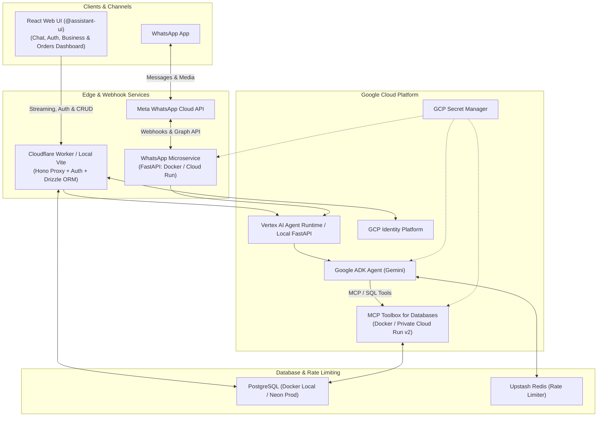

# ☕ Fullstack ADK Coffee Assistant

A multi-tenant fullstack conversational agent built with **Google ADK (Agent Development Kit)** and **Gemini**, featuring a **React + @assistant-ui** web dashboard on **Cloudflare Workers**, **Google Cloud Identity Platform** auth, **Drizzle ORM** + **PostgreSQL / Neon**, a private **MCP Toolbox for Databases** server, a **WhatsApp Cloud API** microservice, **Upstash Redis** rate limiting, and **Terraform** IaC.

🔗 **Live Demo:** [https://coffee-assistant-web.janf-agentic-architect.workers.dev/](https://coffee-assistant-web.janf-agentic-architect.workers.dev/)



---

## 1. Local Setup (Docker Compose)

Run the entire stack locally (**PostgreSQL**, **MCP Toolbox**, **ADK Agent**, **WhatsApp Webhook**, and **Web UI**) with Docker Compose using the **Google AI Studio API** — no Google Cloud project or `gcloud` CLI required.

### Prerequisites

- **[Docker](https://www.docker.com/)** with Docker Compose (`docker compose` v2).
- A **[Google AI Studio API Key](https://aistudio.google.com/apikey)** (Gemini Developer API).

### Environment Configuration

#### 1. Agent environment (`agents/coffee-assistant/.env`)

Copy the example file and add your Google AI Studio API key:

```bash
cp agents/coffee-assistant/.env.example agents/coffee-assistant/.env
```

Edit `agents/coffee-assistant/.env`:

```env
# Required: Google AI Studio API Key (https://aistudio.google.com/apikey)
GOOGLE_API_KEY=your-google-ai-studio-api-key

# Optional: Gemini model override (defaults to gemini-3.5-flash-lite)
MODEL=gemini-3.5-flash-lite
```

> By default, Google ADK uses **Google AI Studio** when `GOOGLE_API_KEY` is set without Vertex AI variables. `docker-compose.yml` also forces `GOOGLE_GENAI_USE_ENTERPRISE=false`, `GOOGLE_GENAI_USE_VERTEXAI=false`, and `RATE_LIMIT_ENABLED=false` on the `agent` container (no GCP project or Upstash Redis needed locally), while production deployments use **Vertex AI** and **Upstash Redis** via Terraform. `GOOGLE_API_KEY` is excluded from `make sync-secrets` so it is never pushed to GCP Secret Manager.

#### 2. *(Optional)* WhatsApp channel environment (`channels/whatsapp/.env`)

Only needed if you want to test the `whatsapp` container locally:

```bash
cp channels/whatsapp/.env.example channels/whatsapp/.env
```

```env
WHATSAPP_TOKEN=your-meta-system-user-access-token
WHATSAPP_APP_SECRET=your-meta-app-secret
WHATSAPP_VERIFY_TOKEN=your-verify-token
# WHATSAPP_PHONE_NUMBER_ID=123456789012345 # Optional: auto-discovered if omitted
```

#### 3. Optional Docker Compose Overrides

You can override default ports or PostgreSQL credentials via shell environment variables or a root `.env` file:

| Variable | Default | Description |
|----------|---------|-------------|
| `WEB_PORT` | `5173` | Host port exposed for the Web UI |
| `POSTGRES_USER` | `postgres` | Local PostgreSQL user |
| `POSTGRES_PASSWORD` | `postgres` | Local PostgreSQL password |
| `POSTGRES_DB` | `coffee_assistant_db` | Local PostgreSQL database name |

### Services Included in `docker-compose.yml`

| Service | Internal Address | Exposed Port | Notes |
|---------|------------------|--------------|-------|
| `postgres` | `postgres:5432` | — | `postgres:19-alpine`, auto-initialized with `infra/postgres-init/init.sql`, persisted in `postgres_data` volume |
| `toolbox` | `http://toolbox:5000` | — | Official MCP Toolbox (`v1.18.0`) serving `mcp/mcp-toolbox/tools.yaml` against `postgres` |
| `agent` | `http://agent:8080` | — | Google ADK FastAPI server connected to `TOOLBOX_URL=http://toolbox:5000` |
| `whatsapp` | `http://whatsapp:8001` | — | FastAPI WhatsApp Cloud API webhook connected to `ADK_API_URL=http://agent:8080` |
| `web` | `http://web:5173` | `http://localhost:5173` | Hono + React `@assistant-ui` app connected to `postgres` and `agent` |

### Running & Stopping the Stack

```bash
# Build images, start all services, wait for healthchecks, and print the Web UI URL
make docker-up

# (Optional) Run on a custom web port
WEB_PORT=3000 make docker-up

# Stream logs from all containers (or a single service: docker compose logs -f agent)
make docker-logs

# Stop and remove containers (keeps the postgres_data volume)
make docker-down

# Stop containers and wipe the local PostgreSQL volume to re-run init.sql cleanly
docker compose down -v
```

> Equivalent raw command: `docker compose up -d --build --wait`. Once ready, open **http://localhost:5173** in your browser.

---

## 2. Deployment

Production deployment is automated via **Terraform** (`infra/`) and the root `Makefile`, provisioning **GCP** (Vertex AI Agent Runtime, private Cloud Run MCP Toolbox, Cloud Run WhatsApp webhook, Identity Platform, Secret Manager, BigQuery telemetry), **Neon Lakebase Postgres**, **Upstash Redis**, and **Cloudflare Workers**.

### Prerequisites

Ensure the following CLIs and accounts are ready:

- **[Python >= 3.10](https://www.python.org/)** and **[uv](https://docs.astral.sh/uv/)**
- **[Google Agents CLI](https://cloud.google.com/vertex-ai/docs)**:
  ```bash
  uv tool install google-agents-cli
  ```
- **[Google Cloud SDK (`gcloud`)](https://cloud.google.com/sdk/docs/install)**:
  ```bash
  gcloud auth login
  gcloud auth application-default login
  ```
- **[Terraform >= 1.5](https://www.terraform.io/)**
- **[Node.js >= 18](https://nodejs.org/)**, **[pnpm](https://pnpm.io/)**, and **[Wrangler CLI](https://developers.cloudflare.com/workers/wrangler/)**:
  ```bash
  npx wrangler login
  ```
- **API Keys**: [Neon](https://neon.tech/) (`neon_api_key`, `neon_org_id`), [Upstash](https://upstash.com/) (`upstash_email`, `upstash_api_key`), and *(optional)* [Meta for Developers](https://developers.facebook.com/) (`whatsapp_token`, `whatsapp_app_secret`).

### Step 1: *(Optional)* Rename the Project

If you cloned this repo as a template for a new project, rename all services, Terraform defaults, DB names, and Worker names in one command:

```bash
make rename NAME=my-assistant
```

### Step 2: Configure Terraform Variables

Copy the template variables file and fill in your credentials:

```bash
cp infra/vars/env.tfvars.example infra/vars/env.tfvars
```

Edit `infra/vars/env.tfvars`:

```hcl
project_name = "coffee-assistant"
region       = "us-east1"

# Neon Lakebase Postgres
neon_api_key = "your-neon-api-key"
neon_org_id  = "org-your-org-id"

# Upstash Redis
upstash_email   = "your-email@example.com"
upstash_api_key = "your-upstash-api-key"

# Meta WhatsApp Cloud API (optional - stored in GCP Secret Manager)
# Phone Number ID, WABA ID, and Verify Token are auto-discovered / auto-generated when omitted.
whatsapp_token      = "your-meta-system-user-access-token"
whatsapp_app_secret = "your-meta-app-secret"

# Option A: Create a new GCP project automatically (requires an active billing account)
# create_project  = true
# billing_account = "012345-6789AB-CDEF01"

# Option B: Use an existing GCP project
project_id = "your-gcp-project-id"
```

### Step 3: Full Deployment (One Command)

Run the complete pipeline (`infra` → `db-neon-push` → `deploy-agent` → `deploy-web` → `deploy-whatsapp`):

```bash
# Using an existing GCP project configured in infra/vars/env.tfvars
make deploy-all

# Or automatically create a new GCP project, link billing, and deploy everything
make deploy-all CREATE_PROJECT=true

# (Optional) Seed Neon with initial sample businesses, products, customers, and orders
make db-neon-seed
```

### Step 4: Incremental / Individual Deployment Commands

Use these targets when updating a specific layer:

| Command | What It Deploys / Updates |
|---------|---------------------------|
| `make infra-plan` | Preview Terraform changes before applying |
| `make infra` | Provision/update GCP, Neon, Upstash, Identity Platform, private MCP Toolbox, and Secret Manager, then run `sync-metadata` |
| `make db-neon-push` | Push Drizzle schema to Neon using `database-url-direct` from Secret Manager |
| `make db-neon-migrate` | Apply generated SQL migrations in `web/drizzle/` against Neon |
| `make db-neon-seed` | Seed Neon with sample data |
| `make deploy-toolbox` | Fast targeted Terraform apply when `mcp/mcp-toolbox/tools.yaml` changes |
| `make sync-secrets` | Sync `agents/coffee-assistant/.env` variables to GCP Secret Manager (skips local-only flags) |
| `make deploy-agent` | Sync metadata & secrets, then deploy the ADK agent to Vertex AI Agent Runtime (`TOOLBOX_URL` auto-bound) |
| `make deploy-status` | Check Vertex AI Agent Runtime deployment status |
| `make deploy-web` | Build & deploy `web/` to Cloudflare Workers and push `AGENT_RUNTIME_API_URL`, `GCP_SA_KEY_JSON`, `DATABASE_URL`, `GCP_IDENTITY_API_KEY`, and `GCP_PROJECT_ID` secrets |
| `make deploy-whatsapp` | Build container via Cloud Build, deploy to Cloud Run, auto-discover Meta `App ID` / `WABA ID` / `Phone Number ID`, and register the webhook URL |
| `make subscribe-whatsapp-waba` | Re-run Meta webhook URL registration and WABA subscription using GCP Secret Manager |

### Managed Secrets (GCP Secret Manager)

Terraform automatically creates and populates these secrets in GCP Secret Manager:
- **Database & Toolbox**: `database-url` (pooled PgBouncer for Cloudflare Workers), `database-url-direct` (direct DDL migrations), `postgres-password`, `toolbox-tools-yaml`, `toolbox-url`.
- **Auth & Rate Limiting**: `gcp-identity-api-key`, `upstash-redis-url`, `upstash-redis-token`.
- **WhatsApp**: `whatsapp-token`, `whatsapp-app-secret`, `whatsapp-verify-token` (auto-generated), `whatsapp-phone-number-id`.

---

## 3. Development & Debugging Tools

For fast iteration with hot-reload, interactive debugging, database inspection, and automated testing, run services natively without rebuilding Docker images.

### Hot-Reload Local Workflows

- **Full native stack (`make dev-all`)**: Starts an ephemeral Docker PostgreSQL container (with automatic `db:push` & `db:seed`), local MCP Toolbox (`http://127.0.0.1:5000`), Agent FastAPI (`http://localhost:8080`, `--reload`), WhatsApp webhook (`http://localhost:8001` + `ngrok` tunnel + automatic Meta webhook registration if `ngrok` is installed), and Vite/Hono Web UI (`pnpm dev`). Pressing `Ctrl+C` cleanly stops all processes and removes the ephemeral database container.
- **Agent + Web only (`make dev`)**: Runs the Agent FastAPI server (`8080`) and Web UI together when PostgreSQL and MCP Toolbox are already running.

### Per-Service Debugging Commands

| Command | Service & Port | Purpose |
|---------|----------------|---------|
| `make dev-agent` | ADK Playground | Launch interactive `agents-cli playground` to test prompts, tools, and session state directly |
| `make dev-agent-api` | `http://localhost:8080` | Run only the Agent FastAPI server with `--reload` |
| `make dev-web` | `http://localhost:5173` | Run only the Vite + Hono frontend/API dev server |
| `make dev-toolbox` | `http://127.0.0.1:5000` | Run local MCP Toolbox binary with `mcp/mcp-toolbox/tools.yaml` (auto-downloads binary via `make install-toolbox`) |
| `make dev-db` | `localhost:5432` | Run an ephemeral `postgres:19-alpine` container with auto `db:push` & `db:seed` |
| `make dev-whatsapp` | `http://localhost:8001` | Run WhatsApp FastAPI webhook + `ngrok` tunnel + auto-register webhook URL with Meta |
| `make dev-whatsapp-server` | `http://localhost:8001` | Run only the WhatsApp FastAPI webhook (`--reload`, no `ngrok`) |
| `make tunnel-whatsapp` | `ngrok -> 8001` | Run only the `ngrok` HTTPS tunnel on port `8001` |

### Database Inspection (Drizzle)

```bash
# Open Drizzle Studio visual database explorer in your browser
make db-studio

# Push schema changes to your local PostgreSQL database
make db-push

# Seed local database with sample data
make db-seed

# Print the active pooled Neon DATABASE_URL from GCP Secret Manager
make get-db-secret
```

### Testing & LLM Evaluation

```bash
# Agent unit & integration tests (tools, tenant callbacks, WhatsApp customer auto-registration, rate limiter)
cd agents/coffee-assistant && uv run pytest tests/unit tests/integration

# WhatsApp channel tests (webhooks, HMAC signature verification, Markdown-to-WhatsApp formatting, media & ADK client)
cd channels && uv run pytest tests/

# Automated ADK LLM quality evaluation
cd agents/coffee-assistant && agents-cli eval
```

### Observability, Logs & Diagnostics

- **Docker logs**: `make docker-logs` (or `docker compose logs -f <service>` for `postgres`, `toolbox`, `agent`, `whatsapp`, `web`).
- **Deployment status**: `make deploy-status` checks Vertex AI Agent Runtime rollout progress; `make sync-metadata` refreshes local `project_id` and `deployment_metadata.json` from Terraform state.
- **Cloud Trace & Logging**: Production agent runs emit distributed traces to **Google Cloud Trace** (model invocations, MCP Toolbox calls, tool latency) and structured logs/analytics to **Cloud Logging** and **BigQuery** (`infra/telemetry.tf`).
- **Cloud Run Metrics**: Monitor ingress latency, instance scaling, and health checks for both `<project_name>-toolbox` and `<project_name>-whatsapp` in Cloud Run.
- **Command index**: Run `make help` at any time to list all available automation targets.

---

## 📄 License

This project is licensed under the Apache 2.0 License. See source file headers for details.
